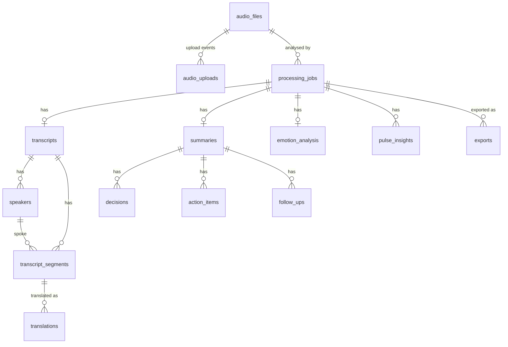

# Teemly database (MySQL 8.0)

The backend stores uploads, processing jobs and every analysis result in MySQL (`teemly_db`), so
results survive a backend restart. The database is optional at runtime: without `DB_USER` (or with
`DB_ENABLED=false`) the API works from memory exactly as before.

## Users and security

| User | Privileges | Used by |
|---|---|---|
| `teemly_app@localhost` | SELECT, INSERT, UPDATE, DELETE on `teemly_db`, `teemly_db_test` | the backend at runtime |
| `teemly_migrator@localhost` | + CREATE, ALTER, INDEX, REFERENCES (and DROP on `teemly_db_test` only) | `npm run db:migrate`, database tests |

- MySQL root is never used by the application; it is only needed once to create these users.
- All queries are parameterized; `multipleStatements` is off; sessions use strict SQL mode.
- Audit logs and upload records store a keyed SHA-256 hash of the client address, never the raw IP,
  and never any conversation content.
- Retention is off by default. If `UPLOAD_RETENTION_HOURS` is set, deleted files keep their database
  rows (`audio_files.deleted_at`), and files used by a running job are never deleted.

## Schema



`audit_logs` and `schema_migrations` stand alone. No `users` table: the application has no login.

| Table | Purpose | Key constraints |
|---|---|---|
| `audio_files` | Stored recording / chat file (random name in `uploads/`), size, SHA-256, duration | UNIQUE `stored_name` |
| `audio_uploads` | Every upload attempt, accepted or rejected (HTTP status, reason) | FK → `audio_files` (SET NULL) |
| `processing_jobs` | One analysis job (`job_id`), status, stage, progress, models, timings | PK = API `job_id`; FK → `audio_files` (RESTRICT) |
| `transcripts` | One per completed job (audio or WhatsApp); language, model, coverage | UNIQUE `job_id`; FK → jobs (CASCADE) |
| `speakers` | Speakers (audio) or senders (WhatsApp) of a transcript | UNIQUE (`transcript_id`, `label`) |
| `transcript_segments` | Lines in the original language, time or message time, emotion | UNIQUE (`transcript_id`, `seq`) |
| `translations` | English translation of each segment | UNIQUE (`segment_id`, `language`) |
| `summaries` | Purpose, overview, final summary, key points, takeaways | UNIQUE `job_id` |
| `decisions`, `action_items`, `follow_ups` | Children of a summary (action items have `status` open/done) | UNIQUE (`summary_id`, `seq`) |
| `emotion_analysis` | Emotion overview: shares, per speaker, timeline | UNIQUE `job_id` |
| `pulse_insights` | Pulse overview, signals (with verified evidence) and recommended actions | UNIQUE (`job_id`, `row_type`, `seq`) |
| `exports` | PDF reports downloaded (title, size, SHA-256; the PDF itself is not stored) | FK → jobs |
| `audit_logs` | upload.accepted / upload.rejected / job.created / job.completed / job.failed / export.created | indexes on event, entity |

All tables: InnoDB, `utf8mb4_0900_ai_ci` (Tamil, Hindi, Telugu, emoji), `created_at` / `updated_at`.
The full definition is in [migrations/001_initial_schema.sql](migrations/001_initial_schema.sql).

### Audio metadata (migration 002)

Original recordings stay in local storage (`backend/uploads/`); MySQL never stores audio data. At
upload the backend checks the file signature, writes the file, re-reads it to verify its SHA-256, and
measures it with **ffprobe** (once per file, 15 s timeout, no shell). Content that ffprobe cannot read
as audio is rejected (422) and deleted; if ffprobe itself cannot run, the upload is kept and the
technical fields stay `NULL` with `metadata_status = 'unavailable'`. Nothing is ever guessed.

| Metadata | Column |
|---|---|
| Original / stored filename | `original_name` / `stored_name` |
| File extension | `file_format` |
| Actual format (container) | `container_format` (002) |
| MIME type (derived on the server) | `mime_type` (002) |
| Size, SHA-256 of the stored file | `size_bytes`, `sha256` |
| Upload timestamp | `created_at` |
| Duration | `duration_seconds` (ffprobe; filled from decoding only if missing) |
| Codec, sample rate, channels, bitrate | `audio_codec`, `sample_rate_hz`, `channels`, `bitrate_bps` (002) |
| Storage provider / path | `storage_provider` (`local`), `storage_path` (`uploads/<stored_name>`) (002) |
| Measurement result | `metadata_status`, `metadata_error` (002) |
| Upload status | `audio_uploads.status` |
| Processing status / job ID | `processing_jobs.status` / `processing_jobs.id` |

Migration 002 only adds nullable columns (or columns with a default), so existing rows stay valid. The
backend works with or without it: it checks once whether the columns exist and, if not, stores the
basic file details only (and logs a reminder to run `npm run db:migrate`). A job start re-checks the
file's SHA-256 against the value recorded at upload and refuses (409) a file that changed.

## Setup (once)

1. Create the users (as a MySQL administrator; the password prompt is MySQL's own). First copy
   [setup/create_users.template.sql](setup/create_users.template.sql) and replace the two password
   placeholders with `DB_PASSWORD` and `DB_MIGRATION_PASSWORD` from `backend/.env`:

   ```powershell
   & "C:\Program Files\MySQL\MySQL Server 8.0\bin\mysql.exe" -u root -p -e "source C:/path/to/create_users.sql"
   ```

   Delete the copy afterwards (it contains the passwords).

2. Fill the `DB_*` settings in `backend/.env` (see `.env.example`).

3. Create the tables (from `backend/`):

   ```powershell
   npm run db:migrate          # apply pending migrations
   npm run db:status           # show applied / pending migrations
   ```

The runner records each migration with a SHA-256 checksum in `schema_migrations`, refuses to run if
an applied migration file was edited, and refuses to create a table that already exists, so existing
data is never touched. Add schema changes as a new file (`002_....sql`), never by editing `001`.

## Tests

```powershell
npm test            # offline tests (no database)
npm run test:db     # MySQL tests, on teemly_db_test only (rebuilt from the migrations each run)
```

`GET http://127.0.0.1:8000/api/db/status` shows the connection, user, server version and applied
migrations (never credentials).
